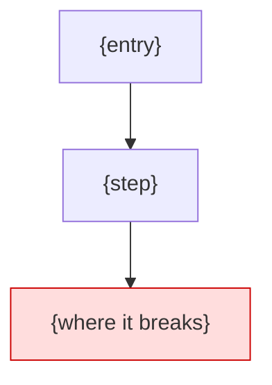
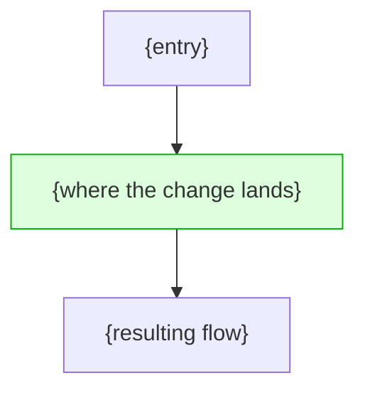

<!-- One round per file: {TICKET}_{NAME}_round{N}.md in the briefs folder the resources file names. Rules live in goal-alignment/SKILL.md. -->

# {TICKET} {feature or fix, one line}, round {N}

## Problem

{What is broken or missing, how to observe it. Fix-round: the prior brief and the one thing it left open.}



## Implementation

**Decisions made:**
1. **{Decision.}** {Resolution, the fact that decided it, the direction rejected.}

**How it lands.** {Order and why. Commit strategy. What stays untouched. Cut any edit this round does not need.}



## Verification

**Target environment:** {the env every check runs against.}

**Prerequisites** (must pass before the loop starts; not proofs):
- {service health, fixture captured, token minted, anything the checks need in place}

**Checks** (plain english; the worker chooses how to check each, api call, api test, or log, and shows the command and result in the transcript):
- {what must be true when the feature works}
- {what must be true at an edge that applies}
- {the full test suite and lint pass}

**Done:** every check run for real, every PR's checks green with a body that says what changed and how it was checked, critic gate posted with findings resolved, {any human follow-up}.

## Compiled /goal condition

```
/goal Implement round {N} of {TICKET} per the brief at {file path}. Done means every check in
the brief passes for real with its evidence in the transcript, the critic gate is posted with
every finding fixed or rebutted, and the final message is a plain-english close of at most
three sentences; or stop after {MAX_TURNS} turns.
```
